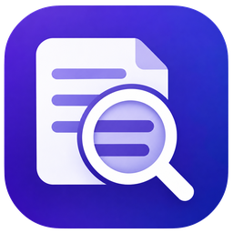

# Search String Builder

**A librarian-style ChatGPT plugin that builds accurate advanced search strings for Scopus, Web of Science Core Collection and EBSCO Academic Search Complete.**

Created by Dr. Arielle Miller · [ariellemiller.com](https://ariellemiller.com) · Instagram, LinkedIn and YouTube: @drarielle

---

## What it does

Every research database has its own search syntax, and small mistakes quietly return the wrong results. Search String Builder interviews you one step at a time, the way a research librarian would. It asks about:

1. which database(s) you're searching
2. your key concepts (3–5 recommended)
3. the keywords for each concept
4. any words that must match exactly
5. subject filters (Scopus Subject Areas, Web of Science Categories and Research Areas, EBSCO subject headings)
6. publication years
7. optional exclusion terms

Then it builds a search string you can paste straight into the database's Advanced Search. A plain-language explanation of how it was built, and tips for when you get too many or too few results, come with every string.

It works for **any discipline**: the sciences, engineering, social sciences, humanities, health and religion.

### What you can ask it to do

| Mode | Example prompt |
| --- | --- |
| Build a search | Build a search string for Scopus |
| Build for several databases at once | Build the same search for Scopus, Web of Science and EBSCO |
| Translate an existing string | Translate this Scopus string to Web of Science: *(paste string)* |
| Teach it a new database | Add a new database profile for IEEE Xplore |

### What it won't do

- **Run searches or show result counts.** It builds the string; you run it in the database.
- **Choose your research concepts.** It recommends checking your concepts with a subject librarian.
- **Make up subject headings.** For EBSCO it uses only the headings you find in the database's Subjects list.

## Install it

> **Directory status:** OpenAI is not currently accepting new skills-only plugins in the public ChatGPT plugin directory. Until it reopens, install the plugin from this repository using one of the options below.

**Option A: ChatGPT Plugin Creator (personal accounts, including Plus)**

1. Download [`dist/search-string-builder-1.0.1-plugin.zip`](dist/search-string-builder-1.0.1-plugin.zip). Click the file, then **Download raw file**.
2. In ChatGPT, switch to **Work** mode and start a new chat.
3. Type `@Plugin Creator`, attach the ZIP, and send: *Install this plugin from the attached ZIP without changing any files.*
4. Delete the ZIP from your ChatGPT **Library** afterwards, so it doesn't appear in the @ list next to the plugin.

**Option B: Skills tab (Business, Enterprise and Edu workspaces)**

Go to **Plugins > Skills > Create > Upload from your computer** and upload the same ZIP. Workspace owners can then share it with colleagues or the whole workspace.

## Using it in ChatGPT

1. Install the plugin (see above).
2. In a new chat, type `@Search String Builder` and choose the entry listed under **Plugins**, not **Files**.
3. Type one of the example prompts above and answer the questions.
4. Copy the final string into the database's Advanced Search box. Check the database name in the plugin's answer for exactly where to paste it.

ChatGPT may also start the plugin on its own when your request clearly matches it.

More detail: [docs/USER_GUIDE.md](docs/USER_GUIDE.md)

## Supported databases

| Database | Profile file | Highlights |
| --- | --- | --- |
| Scopus (Elsevier) | [DB_Scopus.md](plugin/search-string-builder/skills/search-string-builder/references/DB_Scopus.md) | `TITLE-ABS-KEY` on every concept, `{braces}` for exact match, all 27 Subject Area codes |
| Web of Science Core Collection (Clarivate) | [DB_Web_of_Science_Core_Collection.md](plugin/search-string-builder/skills/search-string-builder/references/DB_Web_of_Science_Core_Collection.md) | `TS=` topic searching, the 49-operator limit, Categories (`WC=`) vs Research Areas (`SU=`) |
| EBSCO Academic Search Complete | [DB_EBSCO_Academic_Search_Complete.md](plugin/search-string-builder/skills/search-string-builder/references/DB_EBSCO_Academic_Search_Complete.md) | `XB`/`KW`/`DE` per concept, `#` wildcard for US/UK spellings, `DT` date ranges |

Want another database? See [docs/ADDING_A_DATABASE.md](docs/ADDING_A_DATABASE.md).

## What's in this repository

```
search-string-builder/
├── README.md                 ← you are here
├── CHANGELOG.md              ← release notes
├── PRIVACY.md                ← privacy policy
├── TERMS.md                  ← terms of use
├── LICENSE.md                ← CC BY-NC 4.0
├── docs/
│   ├── USER_GUIDE.md         ← how to use the plugin
│   ├── ADDING_A_DATABASE.md  ← how to add a new database profile
│   └── HOW_IT_WORKS.md       ← design notes and syntax decisions
├── logo.png
├── dist/
│   └── search-string-builder-1.0.1-plugin.zip   ← ready-to-install plugin
└── plugin/
    └── search-string-builder/        ← the plugin package (zip this folder's contents to upload)
        ├── plugin.json
        ├── .codex-plugin/plugin.json
        ├── assets/                   ← icon and logo
        └── skills/search-string-builder/
            ├── SKILL.md              ← the instructions
            ├── references/           ← shared workflow + one profile per database
            └── assets/               ← blank template for new databases
```

The skill follows the open Agent Skills format, so the `skills/search-string-builder/` folder also works in other tools that support skills, such as OpenAI's Codex.

## Disclaimer

Search strings are generated by AI and may contain errors, and database syntax changes over time. Test every string in the database before relying on it, especially for systematic or scoping reviews. This project is not affiliated with Elsevier, Clarivate, EBSCO or OpenAI. See [TERMS.md](TERMS.md) and [PRIVACY.md](PRIVACY.md).

## License

© 2026 Arielle Miller. Licensed under [Creative Commons Attribution-NonCommercial 4.0 International (CC BY-NC 4.0)](https://creativecommons.org/licenses/by-nc/4.0/). You may share and adapt this work for non-commercial purposes with credit to Arielle Miller. See [LICENSE.md](LICENSE.md).

## Contact

Questions, bugs or suggestions: open an [issue](../../issues) or email drajmiller@proton.me.
